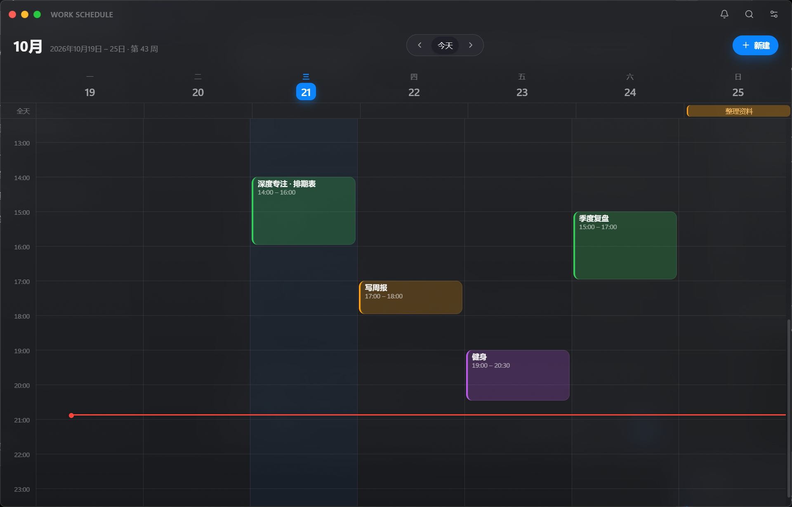

# work schedule

> 一块会自己找你的周日历。周一开头的周视图 + 苹果毛玻璃质感 + 开机/解锁右下角提醒。



## 现在就能跑

```bash
npm install          # 已装好可跳过
npm run dev          # 开发模式（HMR）
npm run build        # 只打包前端/主进程产物到 out/
npm run dist         # 生成 Windows 安装包到 release/
```

> 本机环境提示：如果你从某些工具里启动，注意 `ELECTRON_RUN_AS_NODE=1` 会让 Electron 退化成 Node，`npm run dev` 已经内置清除了这个变量。

## 已实现（对照 plan.md 的 M0–M4）

| 模块 | 状态 | 说明 |
|---|---|---|
| 周视图 | ✅ | 周一 → 周日 7 列 × 24 小时时间轴，事件按时长比例落位，重叠自动分栏，当前时间红线 |
| 周切换 | ✅ | 箭头 / `←` `→` / `PageUp` `PageDown` / `T` 回今天 / 「今天」按钮 |
| 事件 CRUD | ✅ | 点空白处新建（15 分钟吸附）、点事件编辑、拖拽移动（跨天跨时段）、删除 |
| 分类与颜色 | ✅ | 5 个内置分类 + 8 色板，事件块按分类色着色 |
| 重复事件 | ✅ | 每天 / 每周 / 每工作日 / 每月，按需展开；单次修改与删除用例外表 |
| 搜索 | ✅ | 标题 + 备注模糊搜索，分「即将到来 / 过去」，点击跳转并高亮 |
| 提醒 | ✅ | 开机（`--hidden` 静默启动）/ 屏幕解锁 / 睡眠唤醒 / 事件前 N 分钟，四个来源统一收敛，60 秒节流，只显示一条 |
| 提醒窗 | ✅ | 无边框、置顶、**不抢焦点**（`showInactive` + `focusable:false`）、右下角、12 秒自动消失、悬停暂停、`稍后 10 分钟` |
| 托盘常驻 | ✅ | 左键唤起，右键菜单（打开 / 立即提示 / 静音 1 小时 / 开机自启 / 退出） |
| 开机自启 | ✅ | `setLoginItemSettings` + `--hidden`，仅打包版生效（开发时不污染启动项） |
| 毛玻璃 | ✅ | Win11 原生 `backgroundMaterial: 'acrylic'`；CSS 玻璃层 + 噪点 + 高光边；「降低透明度」开关兜底 |
| 完成状态 | ✅ | 每个实例可勾选完成（重复事件按次记录），跨重启保留 |

## 快捷键

| 键 | 作用 |
|---|---|
| `←` / `→` | 上一周 / 下一周 |
| `T` | 回到本周 |
| `N` | 新建事件 |
| `Ctrl + F` | 搜索 |
| `Esc` | 关闭浮层 |
| `Enter`（标题框内） | 保存 |

鼠标 / 触控：空白处单击新建、按住事件块拖动改时间（跨列即改天）、右上角红点隐藏到托盘、黄点最小化、绿点最大化。

## 数据在哪

- 数据库：`%APPDATA%\work schedule\data.db`（SQLite，单文件）
- 表：`events` / `event_exceptions` / `occurrence_state` / `categories` / `settings`
- 时间一律 UTC 存储、本地时区渲染

备份就是拷走这个 `data.db`。

## 打包

```bash
npm run portable   # 便携版 → release/portable（双击 "work schedule.exe" 即用）
npm run dist       # NSIS 安装包 → release/*.exe
```

便携版已产出并压缩为 `release/work-schedule-portable-0.1.0.zip`（约 134MB，解压即用、免安装）。

> ⚠️ 本机已知坑：`electron-builder` 收集依赖时会用 `powershell.exe -EncodedCommand` 起子进程，
> 而这台机器的 PowerShell 启动横幅会污染输出，导致 `No JSON content found in output`。
> 所以安装包暂时改用便携版分发；换到没有该横幅的机器（或临时清空 PowerShell profile）后，`npm run dist` 可直接出安装包。

## 技术栈

Electron 38 + React 19 + TypeScript + Vite 7（electron-vite 5）
持久层用 **Node 内置 `node:sqlite`**（零原生编译），重复规则用 `rrule`，日期用 `date-fns`，校验用 `zod`。

## 目录

```
src/main/       主进程：窗口、托盘、调度器、SQLite、IPC
src/preload/    contextBridge 白名单
src/renderer/   React：周视图 / 编辑器 / 搜索 / 设置 / 提醒卡
src/shared/     主进程与渲染层共享的类型与 IPC 通道
scripts/        图标生成、启动包装、截图脚本
docs/           截图
```

## 已知限制

- 仅 Windows 10/11；Win10 没有原生亚克力，会退化为半透明深色玻璃
- 开机自启只在安装版生效（`app.isPackaged` 为真时才写注册表）
- 时区固定跟随系统，跨时区旅行时历史事件按当前时区渲染
